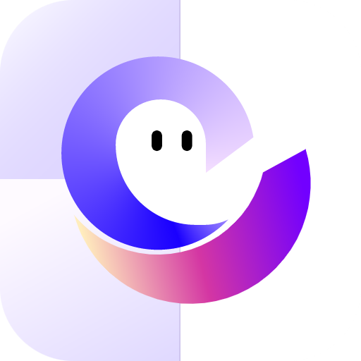

# MobileClaw for Magpie



这是给 Magpie 用的一个**非官方** MobileClaw（移动云）供应商插件。你用自己的 MobileClaw 账号登录，就能在 Magpie 和接进来的 Agent 里用这个账号的模型。

它不是共享账号池，也不是破解：不共享密钥，不绕过验证码、套餐或访问控制。项目跟 MobileClaw、中国移动、Magpie 都没有隶属关系。

当前版本 `0.1.0`，实验性质。上游是私有接口，随时可能变。

## 现在能做什么

已经用真实账号验证过：

- 登录后能拿到这个账号**实际可用**的模型列表，不是写死的假列表；
- 能读取 Coding Plan、Token Plan 和体验额度；
- 模型聊天请求能走通，`magpie provider test mobileclaw` 已成功；
- 多账号、令牌自动续期、流式回复、取消请求都有实现和测试。

还没完全验证或没做的：

- 短信登录、密码登录的完整流程仍建议自己先用小号试；
- 扫码登录、SIM 登录、设置密码没做；
- 企业工作区没做，目前只支持个人工作区；
- 图片、视频、托管搜索等能力没接；
- 登录 400 的具体根因没有完全查清，只修掉了已确认的参数和请求头问题。

## 装它

不用构建，仓库里的文件就是运行文件：

```sh
magpie plugin add github:lyimoexiao/opencode-mobileclaw-auth
magpie plugin login mobileclaw
magpie plugin
```

在 Magpie 应用里也可以打开「插件 → 添加插件」，填：

```text
github:lyimoexiao/opencode-mobileclaw-auth
```

供应商 ID 是 `mobileclaw`。Agent 里选模型时用 `mobileclaw/模型名`。

更新、退出：

```sh
magpie plugin update
magpie plugin logout mobileclaw
```

## 怎么登录

有三种方式，选一种就行。

### 手机号 + 短信验证码

输入手机号，点发送，再填收到的验证码。只有你主动登录时才发短信。

手机号会用 MobileClaw 客户端里的 RSA 公钥加密后再发，短信验证码走 HTTPS。

### 手机号 + MobileClaw 密码

注意：这里要的是**你在 MobileClaw 里设置的密码**，不是移动云控制台密码。手机号和密码都会加密后发送，插件不保存密码。

### 手动导入令牌（高级）

适合你已经从别处拿到明文 access token 的情况。

- Access token 填明文，不要带 `Bearer `；
- Refresh token 可选；
- 如果填了 refresh token，必须同时填**原来登录时的 deviceId**；
- 不要把官方客户端磁盘里的加密字符串直接贴进来，那个不是明文令牌。

插件不会去读你的 MobileClaw 配置、钥匙串，也不会自动解密别的应用的凭据。

### 账号和订阅

- 只有一个移动云账号：`userId` 留空。
- 有多个账号：填你要用的 `userId`。留空会直接报错，不会偷偷替你选一个。
- `aiProvider` 留空时默认用接口返回的第一个订阅；要用别的订阅就填它的标识再登录。
- 目前只支持个人工作区。企业工作区需要 `resId`、`memId`、`orgId` 等绑定，还没做。

## 用模型

未登录时先显示一组保守的占位模型，方便你先看到供应商。登录后会换成你账号真实的模型列表，并按订阅里可用的套餐过滤。

模型请求会带官方要求的 `ai-provider`、`pkg-types`。这里有个坑：Magpie 不会把 `provider.models` 里的模型 `headers` 自动带到聊天请求，所以插件会在第一次聊天前自己查一次模型列表，把对应的套餐头补上。`context-limit` 不在聊天请求里发，官方引擎也不发它；上下文大小放在模型的 `limit.context` 里。

模型列表和支持参数按官方字段对齐：`contextLength`、`maxOutputLength` 按官方引擎的规则乘 1000；`modelTypes` 里的“图片理解”“视频理解”会映射成输入能力，“图片生成”“视频生成”映射成输出能力；`rate` 原样保留；模型可用套餐用 `pkg-types` 过滤。

目前只接了文本 Chat Completions。图片、视频生成任务、托管工具没有接，也不会因为列表里有类型就假装能调用。

## 额度

现在会读三类：

- Coding Plan：日、周、月用了多少、什么时候重置；
- 个人 Token Plan：用了多少 token、总共多少；
- 体验额度：还剩多少 token。

体验额度是“钱包余额”，不是“用了百分之几”。插件不会给它编一个 `used/limit`，也不会把“不知道”显示成 0。

还没汇总金融权益、免费用量统计和企业额度。某个可选接口挂了，不会挡住其他额度；全都没有数据时会明确提示，而不是显示 0% 可用。

## 常见问题

**登录一直 400？**

已确认服务端要求 `mac`、`os`、`deviceId`、`clientVersion`、`hostname` 等字段不能为空；早期版本空 MAC 确实会失败，已修。管理接口也补了官方 Electron UA。

如果还是 400，请提供**具体接口、HTTP 状态和错误码**，不要发手机号、验证码、密码或令牌。不同接口的 400 含义不一样，只看“400”没法定位。

**模型请求 500？**

已定位并修复：缺少 `pkg-types` 会导致上游 500。插件现在会按账号的模型列表补这个头。

**会不会和官方客户端打架？**

如果两边共用同一个 refresh token，可能互相把对方顶下线。想稳一点，用插件单独短信/密码登录，别复用官方客户端的 refresh token。

**会不会被封号？**

插件不伪造官方遥测，也不冒充官方客户端刷使用记录。它只发完成登录、模型列表、额度和聊天所必需的请求。降低风险的正道是遵守服务条款、别共享令牌、别超额度、需要官方环境就用官方客户端。

**能用在原生 OpenCode 吗？**

不保证。插件用的是 Magpie 的登录、续期和用量扩展，原生 OpenCode 不认这些。

## 隐私和安全

- 登录信息由 Magpie 保存，通常在 `~/.config/magpie/plugin-auth.json`；插件自己不再写一份凭据。
- 对话和工具结果只发到 `https://zhenze-huhehaote.cmecloud.cn/desktop/v1/chat/completions`。
- 登录、账号、订阅、额度请求也只去同一个官方域名。
- 带凭据的请求拒绝重定向；模型请求只允许官方域名和 Chat Completions 路径。
- 插件日志不打印手机号、密码、令牌、提示词或服务端错误正文。
- 源码就在仓库里，安装前可以自己看。别把令牌贴到 issue。

## 开发

无运行时依赖，ESM，Magpie 的 Bun 宿主可以直接加载。本地测试用 Node.js 20+：

```sh
npm test
npm run check
```

沙箱试插件，不碰你正在用的 Magpie：

```sh
sb=$(mktemp -d)
m() { env HOME="$sb" XDG_CONFIG_HOME="$sb/.config" XDG_CACHE_HOME="$sb/.cache" MAGPIE_ADDR=127.0.0.1:3499 magpie "$@"; }
m plugin add "$PWD" </dev/null
m plugin --json
# 下面这些会真的登录、可能发短信和消耗一点额度：
m plugin login mobileclaw
m provider test mobileclaw
m quota
m plugin logout mobileclaw
```

技术细节、协议证据和未完成项在：

- [协议调查](docs/PROTOCOL.md)
- [登录 400、UA、遥测和未实现功能复核](docs/FOLLOWUP-AUDIT.md)

测试覆盖 RSA 加密、短信/密码参数、多账号歧义、续期、模型过滤、套餐请求头、流式透传、取消、额度为空和图标。

## English

Unofficial experimental MobileClaw account provider for Magpie. It supports SMS, MobileClaw password and manual token sign-in, account-scoped renewal, subscription-aware model discovery, Coding Plan/Token Plan/experience-credit usage and streaming Chat Completions. Install with `magpie plugin add github:lyimoexiao/opencode-mobileclaw-auth`. No build step or runtime dependencies. Credentials stay in Magpie's auth store and requests go only to the official MobileClaw endpoint. Use your own authorized account and follow the upstream terms. It does not forge official telemetry or impersonate the official client to evade enforcement.

## License

代码是 MIT。`assets/` 里的 MobileClaw 图标只用来标识兼容目标，权利归原方，不在 MIT 授权范围内，详见 [NOTICE](NOTICE)。